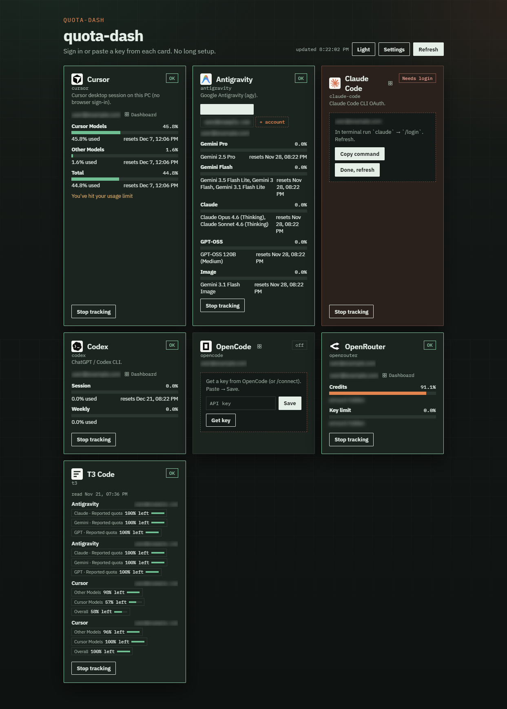
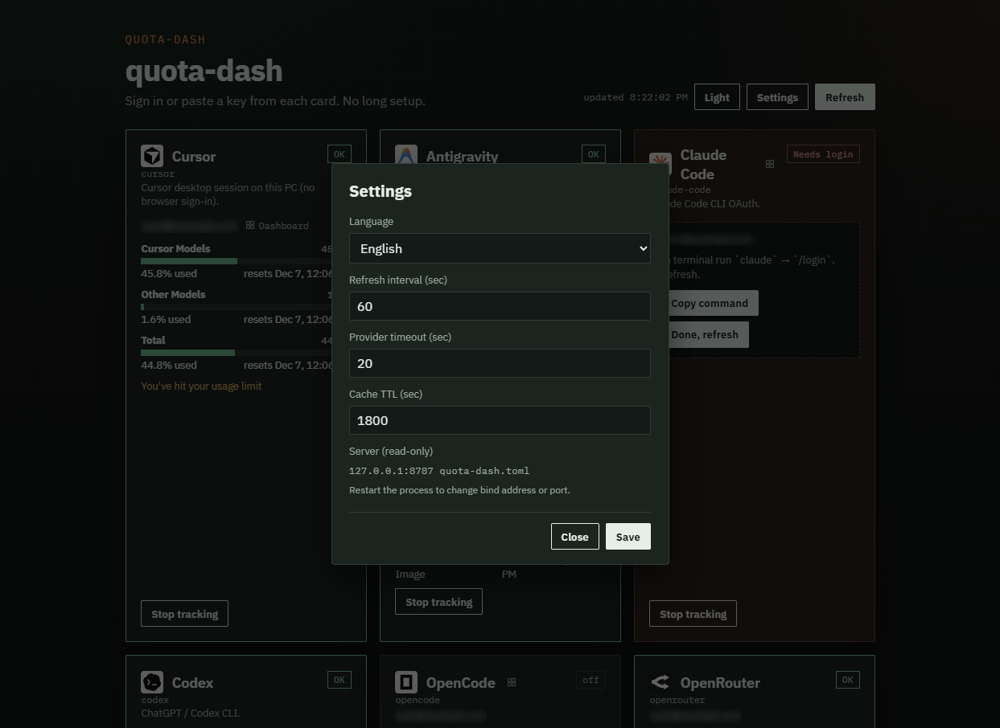

# quota-dash

Local quota dashboard for AI coding agents on Windows. It reads sign-ins already on this PC and shows what is left, in a browser on localhost and over a small HTTP API.





## Features

- Cards for Cursor, Antigravity, Claude Code, Codex, OpenCode, OpenRouter, and T3 Code
- Usage windows with reset times
- Track or stop tracking a provider without signing that app out
- Several Antigravity and T3 accounts on one card
- Light and dark theme (follows the system until you switch)
- 18 UI languages. The first visit follows the Windows display language. Arabic is right-to-left
- Refresh interval, per-provider timeout, and last-good cache TTL in Settings

## Requirements

- Windows 10 or later
- [Rust](https://rustup.rs/) stable, to build from source
- The apps you want to track, already signed in on this machine

Local session discovery uses Windows credential stores and app data. A build on another OS will not find those sign-ins.

## Run

From this directory:

```powershell
Copy-Item config.example.toml quota-dash.toml
cargo run --release
```

Open [http://127.0.0.1:8787/](http://127.0.0.1:8787/). Quotas as JSON: `GET /api/quotas`.

The first argument is an optional config path. With no argument, quota-dash loads `quota-dash.toml`.

Turn a provider on from its card, or add its kind to `enabled_providers`.

## Providers

| | Kind | How it signs in |
|---|------|-----------------|
|  | `cursor` | Cursor desktop session on this PC |
|  | `antigravity` | Google sign-in through the Antigravity CLI (`agy`) |
|  | `claude-code` | Claude Code CLI (`claude`, then `/login`) |
|  | `codex` | Codex CLI (`codex login`) |
|  | `opencode` | API key, pasted in the card |
|  | `openrouter` | API key, pasted in the card or set as `OPENROUTER_API_KEY` |
|  | `t3` | Accounts already signed in to T3 Code. Leave T3 Code open so its cache stays fresh |

Antigravity's percentage, the one-hour access token, and the stale card are described in [docs/antigravity-quota.md](docs/antigravity-quota.md).

## Configuration

`config.example.toml` is the template. Copy it to `quota-dash.toml`. That file is gitignored and is the right place for a local API key.

| Field | Default | Meaning |
|-------|---------|---------|
| `bind` | `127.0.0.1` | Listen address |
| `port` | `8787` | Listen port |
| `refresh_interval_secs` | `60` | Reuse the last full report when it is newer than this |
| `provider_timeout_secs` | `20` | Per-provider fetch timeout |
| `cache_ttl_secs` | `1800` | How long a last-good snapshot may stand in after an error |
| `enabled_providers` | `[]` | Kinds to poll |
| `openrouter_api_key` | `""` | Or the env var `OPENROUTER_API_KEY` |
| `opencode_api_key` | `""` | Used when local OpenCode discovery finds no key |

Changing `bind` or `port` needs a process restart. The other timings can be saved from Settings.

## Security

The server listens on localhost. Leave `bind` at `127.0.0.1`: the API returns the same quotas the UI shows, including account labels. Auth secrets are not written to the log. See [SECURITY.md](SECURITY.md).

## Development

```powershell
cargo test
```

Product copy and translations live in [`data/`](data/README.md), not in Rust. Add a provider by editing `data/providers.json`, every file in `data/locales/`, and a fetch module under `src/providers/`.

## License

[Apache License 2.0](LICENSE). Attribution is in [NOTICE](NOTICE).
